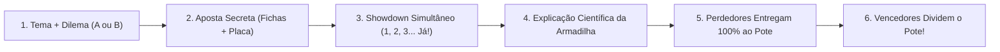

# 🧪🎲 Leilão de Química — O Jogo de Apostas Científicas de Risco Zero

[](specs/SPEC-01-questoes/validate_questions.py)
[](specs/SPEC-02-mecanica/SPEC.md)
[](specs/SPEC-04-impressao/001_manual_do_professor_v001.html)
[](LICENSE)

> *"Em uma aula tradicional, o aluno tem medo de errar e espera o colega responder. Em um leilão mal desenhado, a banca quebra ou um único grupo domina a sala. No **Leilão de Química**, cada dúvida vira tensão estratégica, toda a turma joga junta e quem domina o conceito químico divide as fichas de quem caiu na armadilha."*

---

## 📖 A História por Trás do Jogo: Os 4 Problemas que Precisávamos Resolver

Todo professor de Química do Ensino Médio já viveu a mesma cena: ao projetar uma questão de **Estequiometria**, **Soluções** ou **Química Ambiental**, dois ou três alunos das primeiras carteiras respondem rápido, enquanto o restante da sala apenas concorda em silêncio — ou chuta uma letra qualquer sem pensar.

Quando tentamos transformar a revisão em um **"Leilão de Perguntas"** ou jogo de apostas em sala de aula, esbarramos em **quatro armadilhas clássicas de design de jogos pedagógicos**:

### 1. O Problema da "Plateia Passiva" e do Efeito Manada
Nos leilões tradicionais de sala de aula (onde quem dá o maior lance compra o direito de responder), **apenas uma equipe joga por vez**. As outras cinco equipes ficam assistindo passivamente. Pior: quando as respostas são abertas sequencialmente, os grupos inseguros simplesmente copiam a escolha da equipe "nerd" da turma.

### 2. O Problema da "Quebra da Banca" (Inflação de Fichas)
Em jogos onde o professor promete prêmios fixos (*"Quem acertar ganha o dobro do que apostou!"*), se uma questão for fácil e toda a sala der *All-in* e acertar, o professor precisa pagar milhares de fichas que não tem. A economia do jogo colapsa na terceira rodada.

### 3. O Problema da "Decoreba Óbvia" vs. Chute Cego
Questões de múltipla escolha com 4 ou 5 alternativas costumam ter opções absurdas que os alunos eliminam sem saber Química, ou exigem decoreba pura. Não há **calibração de risco**: o aluno não precisa medir *o quanto* ele realmente confia no próprio raciocínio.

### 4. O Problema da "Eliminação Precoce"
Basta uma equipe empolgada apostar todas as suas fichas na 1ª rodada e errar para que aqueles alunos fiquem 40 minutos de braços cruzados, excluídos da aula.

---

## 💡 A Solução: Como o **Leilão de Química** Reinventa a Dinâmica de Sala

Para resolver esses quatro problemas de uma só vez, combinamos **Engenharia Pedagógica (Concepções Alternativas do ENEM)** com a matemática dos **Sistemas Pari-Mutuel (Bolão Mútuo de Risco Zero)** e o suspense do **Texas Hold'em**:



### ✅ 1. Engajamento 100% Simultâneo e Zero Efeito Manada
Toda questão apresenta apenas **duas alternativas (`A` ou `B`)**. Após 45–60 segundos de debate interno, cada equipe escolhe secretamente sua placa (**A** ou **B**) virada para baixo e separa suas cédulas de **Tokens (`T$`)**. Ao comando *"1, 2, 3... Revelar!"*, todas as equipes levantam suas placas juntas. **Ninguém copia ninguém e todas as equipes jogam todas as rodadas.**

### ✅ 2. Matemática Pari-Mutuel Sem Comissão (Risco Zero Absoluto para a Casa)
O professor **nunca tira 1 ficha do próprio bolso**. O jogo funciona como uma bolsa de apostas fechada: **quem acerta recupera a própria aposta e divide integralmente o dinheiro deixado por quem errou**, proporcionalmente ao valor que arriscou!

$$\text{Multiplicador } (O) = \frac{\text{Pote Total Apostado por Todos } (T_A + T_B)}{\text{Total Apostado na Alternativa Certa}}$$

$$\text{Pagamento da Equipe} = \left\lfloor \frac{\text{Sua Aposta} \times O}{50} \right\rfloor \times 50\text{ T\$}$$

* **Cálculo Mental Instantâneo:** Sem taxas percentuais complicadas durante a partida.
* **Regra do Troco da Casa (*Breakage* em `50 T$`):** Como a menor nota do jogo é de `50 T$`, qualquer fração quebrada menor que `50 T$` fica no **Caixa da Casa**.
* **E se 100% da turma acertar?** O multiplicador dá exatamente $1,00\times$: cada equipe recebe suas fichas de volta. A Casa nunca perde!
* **E se 100% da turma errar?** O Pote não some: ele **acumula (*Jackpot / Rollover*)** para a pergunta seguinte, transformando a próxima rodada em uma disputa eletrizante!

### ✅ 3. Questões Calibradas na Dúvida Real (Concepções Alternativas vs. Ciência)
Nenhuma alternativa é boba. Cada carta confronta o conceito científico correto com o **erro cognitivo mais sedutor** mapeado na literatura de Ensino de Química:
* *Diluir $100\text{ mL}$ com mais $300\text{ mL}$ de água:* você divide por $300\text{ mL}$ (água adicionada) ou por $400\text{ mL}$ (volume final)?
* *Misturar $100\text{ mL}$ de $\text{NaCl}\; 1,0\text{ mol/L}$ com $300\text{ mL}$ de $\text{NaCl}\; 3,0\text{ mol/L}$:* dá a média simples ($2,0\text{ mol/L}$) ou a média ponderada ($2,5\text{ mol/L}$)?
* *Reagente Limitante em proporção $1:2$:* o reagente em menor quantidade de mols (ou menor massa em gramas) é sempre o limitante?
* *Química Ambiental:* o efeito estufa vem dos buracos de CFC na camada de ozônio ou da absorção de radiação infravermelha por $\text{CO}_2$ e $\text{CH}_4$?

### ✅ 4. Proteção Pedagógica, Repescagem Científica e Clímax *Texas Hold'em*
* **Rodada 0 (Rodada-Treino valendo `0 T$`):** Antes do jogo valendo, o professor conduz 1 rodada simulada para que todos dominem a conta do pote na prática.
* **Teto de Segurança nas Fases 1 e 2:** Aposta mínima de `50 T$` e máxima de `500 T$` (metade da banca inicial de `1.000 T$`), impedindo falências acidentais no início.
* **Repescagem Científica (`+50 T$`):** Se uma equipe zerar suas fichas (`0 T$`), ela nunca abandona a aula — basta ir ao quadro e explicar oralmente a justificativa científica de uma questão para receber `50 T$` financiados pelo troco acumulado no Caixa da Casa!
* **🔥 Fase 3 — Morte Súbita estilo *Texas Hold'em* ("Aposta no Tema no Escuro"):**
  1. **No Escuro:** O professor anuncia **APENAS O TEMA** da carta (ex.: *"Diluição Laboratorial"* ou *"Limitante + Rendimento"*). Sem ver a pergunta, cada equipe faz uma aposta obrigatória (mínimo `100 T$`) medindo o quanto confia no próprio domínio daquele assunto.
  2. **Showdown (Check ou Raise / All-in):** O professor lê o enunciado e as opções A e B. Cada equipe escolhe A ou B em segredo e decide se apenas **mantém** o que já pôs (**Check**) ou se **aumenta a aposta / dá All-in** (**Raise**) antes da revelação simultânea!

---

## 🎯 Exemplo Real: A Rodada-Treino em Ação

Imagine 3 equipes (**Alfa**, **Beta** e **Gama**) disputando uma questão cuja resposta correta é a alternativa **B**:

| Equipe | Escolheu | Apostou | Conta Bruta ($\times 1,8$) | Recebe (em notas de `50 T$`) | Resultado Líquido |
| :--- | :---: | :---: | :---: | :---: | :---: |
| **Equipe Alfa** | Opção A ❌ | `200 T$` | Perde tudo para o Pote | **`0 T$`** | **$-200\text{ T\$}$** |
| **Equipe Beta** | Opção B ✅ | `100 T$` | $100 \times 1,8 = 180\text{ T\$}$ | **`150 T$`** | **$+50\text{ T\$}$ (lucro)** |
| **Equipe Gama** | Opção B ✅ | `150 T$` | $150 \times 1,8 = 270\text{ T\$}$ | **`250 T$`** | **$+100\text{ T\$}$ (lucro)** |

* **Pote Total ($P$):** $200 + 100 + 150 = \mathbf{450\text{ T\$}}$
* **Total Apostado na Certa ($T_B$):** $100 + 150 = \mathbf{250\text{ T\$}}$
* **Multiplicador ($O_B$):** $450 \div 250 = \mathbf{1,8\times}$
* **Soma paga aos vencedores:** $150 + 250 = \mathbf{400\text{ T\$}}$
* **Troco da Casa (*Breakage*):** $450 - 400 = \mathbf{50\text{ T\$}}$ *(guardado no Caixa da Casa para bancar futuras Repescagens Científicas)*.

---

## 🖨️ Materiais Prontos para Imprimir (`SPEC-04-impressao`)

Todos os materiais gráficos possuem design editorial suíço, tipografia química formatada e estão organizados por **3 dígitos (`001` a `023`)** na pasta [`specs/SPEC-04-impressao/`](specs/SPEC-04-impressao/). Basta abrir no navegador (`Chrome` / `Edge`), pressionar `Ctrl + P` em papel **A4** e ativar *"Gráficos de segundo plano"*:

| Código | Arquivo HTML | Para Quem | Descrição |
| :---: | :--- | :---: | :--- |
| **`001`** | [`001_manual_do_professor_v001.html`](specs/SPEC-04-impressao/001_manual_do_professor_v001.html) | 👨‍🏫 Professor | **Manual Didático Completo (2 págs A4):** checklist, roteiro falado da Rodada-Treino ao vivo, condução da Fase 3 *Texas Hold'em* e mapa de armadilhas. |
| **`002`** | [`002_guia_do_mestre_cheat_sheet_v001.html`](specs/SPEC-04-impressao/002_guia_do_mestre_cheat_sheet_v001.html) | 👨‍🏫 Professor | **Gabarito Rápido (1 pág A4):** tabela consolidada dos Lotes 001 a 025 com resposta vencedora (A ou B) e resumo da resolução. |
| **`003`** | [`003_ficha_controle_leilao_v001.html`](specs/SPEC-04-impressao/003_ficha_controle_leilao_v001.html) | 👨‍🏫 Professor | **Planilha de Arbitragem (1 pág A4):** registro da Rodada 0 de Treino, apostas $T_A$ e $T_B$, Pote Total, Multiplicador e Caixa da Casa. |
| **`004`** | [`004_regras_do_aluno_v001.html`](specs/SPEC-04-impressao/004_regras_do_aluno_v001.html) | 🧑‍🎓 Alunos | **Folha Visual das Equipes (1 pág A4):** o jogo em 1 frase, os 6 passos, a conta do pote, a Rodada-Treino ilustrada e a Fase 3 *Texas Hold'em*. |
| **`005`** | [`005_cartoes_regras_mesa_v001.html`](specs/SPEC-04-impressao/005_cartoes_regras_mesa_v001.html) | 🧑‍🎓 Alunos | **Cartões de Mesa (4 por folha A4):** resumo rápido de bolso para deixar sobre a carteira de cada grupo. |
| **`006`** | [`006_dinheiro_para_imprimir_v001.html`](specs/SPEC-04-impressao/006_dinheiro_para_imprimir_v001.html) | 💵 Banca | **Cédulas de Tokens (`50`, `100` e `500 T$`):** 120 notas com numerais nos 4 cantos para recortar. |
| **`007`** | [`007_duplex_intercalado_para_imprimir_v001.html`](specs/SPEC-04-impressao/007_duplex_intercalado_para_imprimir_v001.html) | 🃏 Baralho | **Baralho Completo Frente e Verso (Duplex):** páginas pares já espelhadas horizontalmente para encaixe milimétrico no corte. |
| **`008–011`** | `008` a `011_*_v001.html` | 🃏 Baralho | Frentes e versos separados de todas as 25 cartas de Perguntas e Respostas. |
| **`012–023`** | `012` a `023_*_v001.html` | 🃏 Baralho | Cartas separadas por nível: **Nível 1** (`012–015`), **Nível 2** (`016–019`) e **Nível 3** (`020–023`). |

---

## 🏗️ Arquitetura de Engenharia: Spec-Driven & Validação Simbólica

Este repositório não é apenas um conjunto de arquivos estáticos: ele é um **sistema auditável em 5 camadas (`SPEC-00` a `SPEC-04`)** onde a Química, a Matemática e o Design Gráfico são validados por código:

```text
Leilão-Química-v1.00/
├── specs/
│   ├── SPEC-00-fundamentos/   # Base de Conhecimento Químico (conceitos, fórmulas, elementos IUPAC, unidades SI)
│   ├── SPEC-01-questoes/      # 25 questões binárias (A/B) recalculáveis via SymPy + validação de erros comuns
│   ├── SPEC-02-mecanica/      # Motor matemático Pari-Mutuel de Risco Zero + testes exaustivos de Breakage
│   ├── SPEC-03-gerador/       # Compilador Jinja2 (deck_builder.py) que constrói todos os materiais e a Rodada-Treino
│   └── SPEC-04-impressao/     # 23 arquivos HTML A4 versionados (001 a 023 _v001) + folha de estilo Swiss Grid
├── .github/workflows/ci.yml   # Pipeline de Integração Contínua (testa toda a ciência e mecânica a cada push)
├── CONTRIBUTING.md            # Guia para professores e desenvolvedores criarem novas questões validadas
├── LICENSE                    # Licença MIT (Código e material didático abertos)
└── pyproject.toml             # Configuração unificada do projeto Python
```

### Garantias Automatizadas por Código:
1. **Zero Duplicação Científica (`SPEC-00`):** As questões não inventam constantes ou massas atômicas soltas; elas referenciam IDs formais (`CHEM-ELE-011`, `CHEM-FRM-004`) validados contra a base.
2. **Recálculo Simbólico com `SymPy` (`SPEC-01`):** O validador resolve algebricamente cada equação química, converte unidades (`mL` $\rightarrow$ `L`, `g` $\rightarrow$ `mol`) e falha se o gabarito divergir da física/química real.
3. **Prova Exaustiva de Risco Zero (`SPEC-02`):** A suíte de testes simula dezenas de combinações de apostas e *rollovers*, provando matematicamente que a Casa jamais tem prejuízo e que nenhum vencedor recebe menos do que apostou.

---

## 🚀 Como Executar, Validar e Gerar Novos Baralhos

### Pré-requisitos
* Python **3.11+**

### 1. Instalar dependências
```bash
pip install -e ".[dev]"
```

### 2. Rodar os validadores científicos e a suíte de testes completa
```bash
# Valida a Base de Conhecimento Químico (SPEC-00)
python specs/SPEC-00-fundamentos/validate_knowledge.py

# Recalcula todas as questões via SymPy e verifica distratores (SPEC-01)
python specs/SPEC-01-questoes/validate_questions.py

# Valida as regras econômicas Pari-Mutuel (SPEC-02)
python specs/SPEC-02-mecanica/validate_rules.py

# Executa todos os testes automatizados (SPEC-01, SPEC-02 e SPEC-03)
pytest
```

### 3. Recompilar os 23 arquivos HTML de impressão
```bash
python specs/SPEC-03-gerador/deck_builder.py
```

---

## 🤝 Como Contribuir

Quer adicionar novas questões de Termoquímica, Cinética, Equilíbrio ou Eletroquímica mantendo a validação simbólica? Leia o nosso **[Guia de Contribuição (CONTRIBUTING.md)](CONTRIBUTING.md)**.

---

## 📄 Licença

Distribuído sob a **[Licença MIT](LICENSE)**. Professores, escolas e pesquisadores têm liberdade total para imprimir, aplicar em sala de aula, adaptar e compartilhar!
